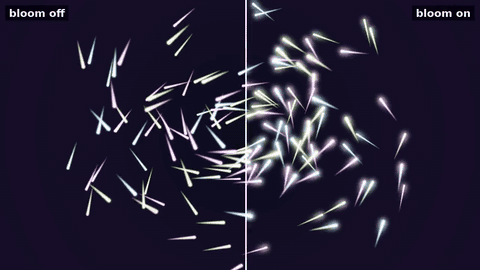

# lumen: HolyC OpenGL shaders

Real-time fragment shader scenes, driven by a small HolyC host program. HolyC opens the window, creates the OpenGL 3.3 context, compiles the shaders, feeds them uniforms, runs the frame loop and the post-processing chain. The pictures themselves are drawn on the GPU.

Scenes render in linear HDR into a floating point framebuffer. A two-pass separable bloom, tone mapping and gamma correction are applied afterwards.

## Bloom



The divider sweeps across the frame: bloom off on the left, bloom on on the right. The other scenes: [raymarch](docs/media/raymarch-compare.gif), [fractal](docs/media/fractal-compare.gif), [plasma](docs/media/plasma-compare.gif). Full quality mp4: [particles](docs/media/particles-compare.mp4), [raymarch](docs/media/raymarch-compare.mp4), [fractal](docs/media/fractal-compare.mp4), [plasma](docs/media/plasma-compare.mp4).

How it works, in the order the GPU runs it:

1. **Scene pass.** The scene's fragment shader draws into an `RGBA16F` texture. Values above 1.0 are kept, so a light that is eight times brighter than white stays eight times brighter.
2. **Bright pass.** The first blur pass reads the scene texture and keeps only what exceeds a threshold of 1.0, with a soft knee so the cutoff does not show as an edge.
3. **Blur.** A 9-tap Gaussian, written as 5 bilinear taps, runs horizontally into one half-resolution texture, then vertically into a second. That pair runs 4 times, each round blurring the previous result, so the glow spreads wider than one kernel allows.
4. **Composite.** The scene and the blurred texture are added, tone mapped with an ACES curve and gamma corrected into the window.

Splitting a 2D Gaussian into a horizontal and a vertical pass turns `N x N` texture reads per pixel into `2N`. Working at half resolution cuts the cost by another factor of four, and the blur hides the lost detail.

Without bloom, bright pixels clip to white and stop there. With it, they leak light into their neighbours, which is why the emitters in the raymarch scene and the comet heads read as hot rather than just white.

The code is in `src/post.HC` and `shaders/post/`.

## Scenes

### raymarch


A signed distance field scene: a blended pair of spheres, a rotating torus and a box over a checkered floor. Soft shadows, ambient occlusion, rim light and one mirror bounce. [Full quality mp4](docs/media/raymarch.mp4)

### fractal


A Mandelbulb whose power animates between 4 and 8. Colour comes from an orbit trap, and the background glow comes from how many steps each ray took. [Full quality mp4](docs/media/fractal.mp4)

### particles


140 comets on tilted elliptical orbits. Each trail is a distance-to-segment function, the glow is additive, and a tone map keeps overlaps from clipping. Hold the mouse to pull them. [Full quality mp4](docs/media/particles.mp4)

### plasma


Four summed sine fields pushed through a cosine palette. The smallest scene, and a good one to read first. [Full quality mp4](docs/media/plasma.mp4)

## Run it

Needs [hcc](https://github.com/Jamesbarford/holyc-lang), SDL2 and a GPU driver with OpenGL 3.3.

```sh
hcc src/main.HC -o build/lumen
./build/lumen            # opens the raymarch scene
./build/lumen fractal    # or any file in shaders/
```

| Key | Action |
|---|---|
| 1 to 4 | switch scene |
| B | toggle bloom |
| R | reload the current scene |
| Esc | quit |
| Left mouse drag | orbit the camera (raymarch, fractal) or pull the particles (particles) |

## Hot reload

The running scene's `.frag` file is re-read every 250 ms. Save it and the new version compiles in place. If it fails to compile, the error prints to the terminal and the previous version keeps running, so a typo never blanks the window.

## Writing a scene

A scene is one file in `shaders/` that defines `mainImage`. Output linear HDR colour: do not apply gamma or tone mapping, the composite pass does that.

```glsl
void mainImage(out vec4 c, in vec2 fc)
{
  vec2 uv = fc / iResolution.xy;
  c = vec4(uv, 0.5 + 0.5 * sin(iTime), 1.0);
}
```

The host prepends the `#version` line and these uniforms, and appends the `main` that calls `mainImage`:

| Uniform | Type | Meaning |
|---|---|---|
| `iResolution` | `vec3` | framebuffer width and height in pixels |
| `iTime` | `float` | seconds since start (frame index over fps when rendering offline) |
| `iMouse` | `vec4` | x, y in pixels, z is 1.0 while the left button is held |

Compile error line numbers match the scene file, because the prelude ends with `#line 1`.

## Offline rendering

The videos above are produced by the program itself, not by screen capture. `--render` draws frames into a hidden window at a fixed time step and writes them as PPM files:

```sh
./build/lumen --render <scene> <out-dir> <frames> <fps> <width> <height> <bloom 0|1>
scripts/record.sh [scene...]              # renders, then encodes mp4 and gif with ffmpeg
scripts/record.sh --compare [scene...]    # bloom off and on with a sweeping divider
```

Because time comes from the frame index, the output is the same on every run and does not depend on how fast the machine is.

## Layout

```
src/main.HC       window, scene loading, hot reload, offline renderer
src/post.HC       framebuffers, bloom passes and the final composite
src/gl.HC         OpenGL 3.3 declarations and the shader compile/link helpers
src/sdl2.HC       SDL2 declarations and input helpers
shaders/*.frag    the scenes
shaders/post/     blur and composite shaders
scripts/record.sh frame render and video encode
```

The vertex stage is a single triangle generated from `gl_VertexID`, so there are no vertex buffers. Every pixel of the screen is shaded by the scene's fragment function.

## Known limits

- Bloom runs at half resolution with a fixed threshold, strength and round count (constants at the top of `src/post.HC`). They are not uniforms yet.
- Tested on Linux with Mesa on an Intel GPU. macOS needs `-clibs "-framework OpenGL"` and has not been tried.

## Credits

The SDL2 and OpenGL declarations come from [holyc-graphics-guide](https://github.com/YatoVoid/holyc-graphics-guide). Distance functions follow the standard formulas from Inigo Quilez's articles.

MIT licensed.
