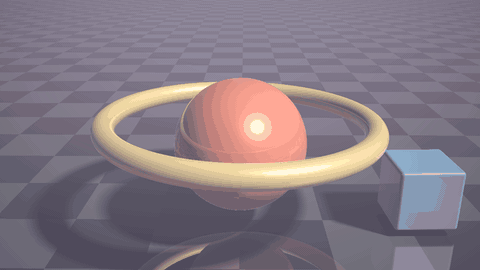
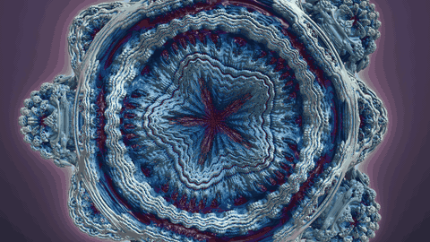
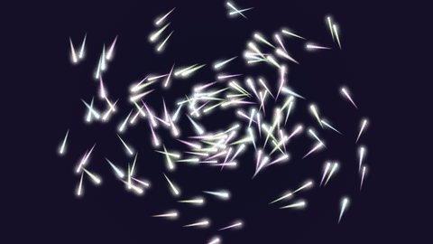
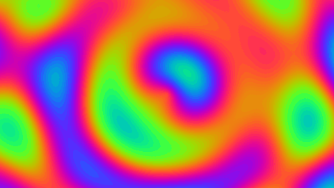

# lumen

Real-time fragment shader scenes, driven by a small HolyC host program. HolyC opens the window, creates the OpenGL 3.3 context, compiles the shaders, feeds them uniforms and runs the frame loop. The pictures themselves are drawn on the GPU.

## Scenes

### raymarch



A signed distance field scene: a blended pair of spheres, a rotating torus and a box over a checkered floor. Soft shadows, ambient occlusion, rim light and one mirror bounce. [Full quality mp4](docs/media/raymarch.mp4)

### fractal



A Mandelbulb whose power animates between 4 and 8. Colour comes from an orbit trap, and the background glow comes from how many steps each ray took. [Full quality mp4](docs/media/fractal.mp4)

### particles



140 comets on tilted elliptical orbits. Each trail is a distance-to-segment function, the glow is additive, and a tone map keeps overlaps from clipping. Hold the mouse to pull them. [Full quality mp4](docs/media/particles.mp4)

### plasma



Four summed sine fields pushed through a cosine palette. The smallest scene, and a good one to read first. [Full quality mp4](docs/media/plasma.mp4)

## Run it

Needs [hcc](https://github.com/Jamesbarford/holyc-lang), SDL2 and a GPU driver with OpenGL 3.3.

```sh
hcc src/main.HC -o build/lumen
./build/lumen            # opens the raymarch scene
./build/lumen fractal    # or any file in shaders/
```

| Key | Action |
|---|---|
| 1 to 4 | switch scene |
| R | reload the current scene |
| Esc | quit |
| Left mouse drag | orbit the camera (raymarch, fractal) or pull the particles (particles) |

## Hot reload

The running scene's `.frag` file is re-read every 250 ms. Save it and the new version compiles in place. If it fails to compile, the error prints to the terminal and the previous version keeps running, so a typo never blanks the window.

## Writing a scene

A scene is one file in `shaders/` that defines `mainImage`:

```glsl
void mainImage(out vec4 c, in vec2 fc)
{
  vec2 uv = fc / iResolution.xy;
  c = vec4(uv, 0.5 + 0.5 * sin(iTime), 1.0);
}
```

The host prepends the `#version` line and these uniforms, and appends the `main` that calls `mainImage`:

| Uniform | Type | Meaning |
|---|---|---|
| `iResolution` | `vec3` | framebuffer width and height in pixels |
| `iTime` | `float` | seconds since start (frame index over fps when rendering offline) |
| `iMouse` | `vec4` | x, y in pixels, z is 1.0 while the left button is held |

Compile error line numbers match the scene file, because the prelude ends with `#line 1`.

## Offline rendering

The videos above are produced by the program itself, not by screen capture. `--render` draws frames into a hidden window at a fixed time step and writes them as PPM files:

```sh
./build/lumen --render <scene> <out-dir> <frames> <fps> <width> <height>
scripts/record.sh [scene...]     # renders, then encodes mp4 and gif with ffmpeg
```

Because time comes from the frame index, the output is the same on every run and does not depend on how fast the machine is.

## Layout

```
src/main.HC       window, scene loading, hot reload, offline renderer
src/gl.HC         OpenGL 3.3 declarations and the shader compile/link helpers
src/sdl2.HC       SDL2 declarations and input helpers
shaders/*.frag    the scenes
scripts/record.sh frame render and video encode
```

The vertex stage is a single triangle generated from `gl_VertexID`, so there are no vertex buffers. Every pixel of the screen is shaded by the scene's fragment function.

## Known limits

- One pass per scene. There is no framebuffer chain, so bloom and blur are approximated inside each scene.
- Tested on Linux with Mesa on an Intel GPU. macOS needs `-clibs "-framework OpenGL"` and has not been tried.

## Credits

The SDL2 and OpenGL declarations come from [holyc-graphics-guide](https://github.com/YatoVoid/holyc-graphics-guide). Distance functions follow the standard formulas from Inigo Quilez's articles.

MIT licensed.
